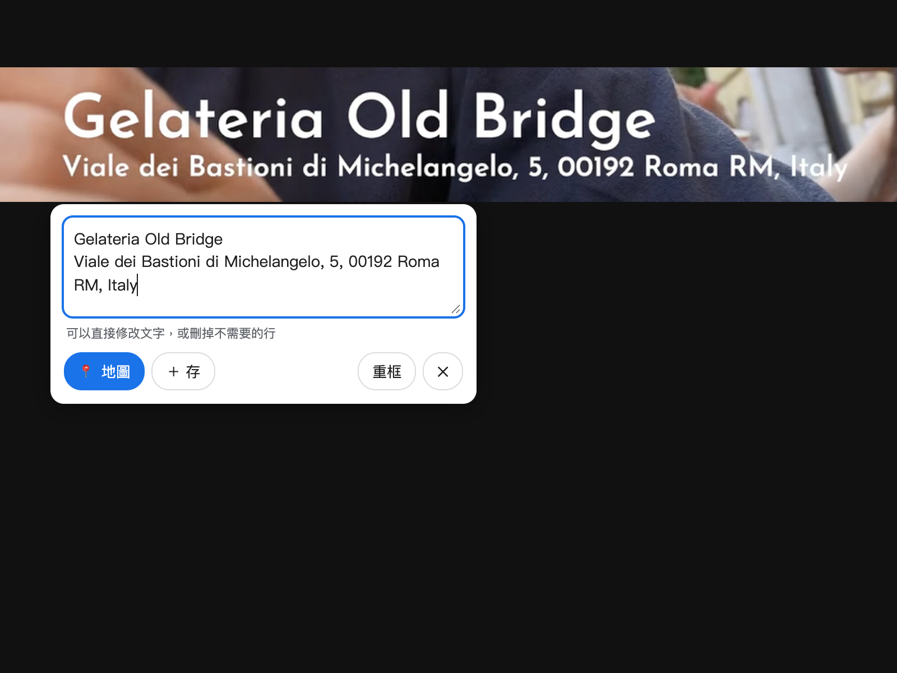

# Maps Picker - 反白找地圖

反白網頁上的地址或店名，或直接框選影片畫面上的字幕、招牌，一鍵在 Google Maps 開啟。文字辨識全部在本機執行，截圖不會上傳。

## 安裝（一次就好）
0. 下載這個專案：右上角 `Code` → `Download ZIP` 解壓縮，或 `git clone`
1. Chrome 網址列輸入 `chrome://extensions`
2. 右上角打開「開發人員模式」
3. 按「載入未封裝項目」→ 選這個 `maps-picker` 資料夾
4. 建議把擴充功能圖示釘選到工具列

## 使用
- **反白文字** → 旁邊跳出 `📍 地圖`、`⧉ 複製`
- **右鍵** → 「在 Google Maps 搜尋…」
- **快捷鍵**：`⌥⇧M` 開地圖（可到 `chrome://extensions/shortcuts` 修改）
- **框選畫面文字**（影片上燒進去的字幕、看板、圖片）：按 `⌥⇧X`，或點工具列圖示 →「⛶ 框選畫面」
  1. 影片會自動暫停，畫面變暗
  2. 拖曳框住地址/店名（只框文字，越貼近越準）
  3. 約 1 秒後出現辨識結果，可以直接修改，再按 `📍 地圖` 或 `⧉ 複製`（`⌘Enter` = 開地圖、`Esc` = 取消）
  4. 繁中、簡中、日文、英文會自動辨識，不用選語言。工具列彈出視窗裡的「備援辨識語言」只在主要辨識認不出來、改用 Tesseract 時才有作用
  5. 直書（招牌、菜單、日文看板）：文字方向預設「自動」，又高又窄的字串會當直書辨識；只有兩三個字的短直欄，可在彈出視窗選「直書」比較準
  - 一定要用快捷鍵或工具列按鈕啟動（Chrome 規定截圖需要使用者觸發）

## 待存清單（預設關閉）
想先收集一堆地點、最後再一次處理時用。在工具列彈出視窗勾「啟用「＋ 存」待存清單」後：
- 反白工具列、框選辨識框、右鍵選單會多出 `＋ 存`；快捷鍵可到 `chrome://extensions/shortcuts` 自己設定
- 清單存在本機瀏覽器（`chrome.storage.local`），不會上傳
- 點工具列圖示看清單：點地點名開 Maps；點來源可回到影片（YouTube 會記住存的當下秒數）

### 存到 Google Maps
Google 沒有開放 API 讓程式直接加入「已儲存」清單，所以有兩種做法：
- 清單按「全部開啟」→ 每個分頁按 Google Maps 上的「儲存」
- 按「匯出 CSV」→ 到 https://www.google.com/maps/d/ (我的地圖) 建立地圖 → 匯入 CSV，
  位置欄選「名稱/地址」，一次把全部地點標上地圖

## 檔案
- `manifest.json`：擴充功能設定；`icons/`：圖示
- `content.js`：反白浮動按鈕、框選遮罩與辨識結果面板
- `background.js`：右鍵選單、快捷鍵、清單儲存、截圖
- `offscreen.html` / `offscreen.js`：文字辨識的隱藏頁面，全部在本機執行，截圖不會上傳
- `paddle.js`：主要辨識，PaddleOCR PP-OCRv5（先偵測文字行、再逐行辨識）
- `ocr.js`：辨識入口；Paddle 結果不好時改用 Tesseract（影像前處理 + 多種版本挑最好的）
- `vendor/paddle/`：PP-OCRv5 mobile 偵測／辨識模型（ONNX，來自 RapidOCR）與字典（Apache-2.0）
- `vendor/onnxruntime/`：onnxruntime-web 1.30 WASM 版（MIT）
- `vendor/tesseract/`：Tesseract.js 7 與語言資料，含直書模型 `chi_tra_vert`、`jpn_vert`（Apache-2.0）

## 授權
專案程式碼採用 [MIT License](LICENSE)。`vendor/` 內的第三方元件各自依其授權發布，詳見 [THIRD_PARTY_NOTICES.md](THIRD_PARTY_NOTICES.md)。
